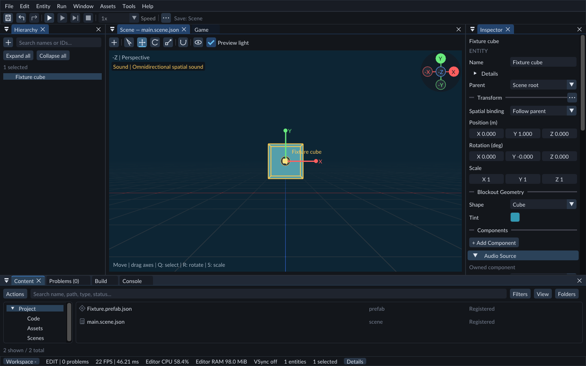

# Your first scene

This walkthrough creates two blocks, organizes them, saves a scene, and previews it.

The Scene workspace: select an object in Hierarchy, then edit it in Inspector.

## Open the editor

1. Extract the entire Windows ZIP into a folder on your Windows PC.
2. Keep the extracted folders together. The editor and its DLLs are in `bin/`; the included C++ SDK is in `NativeSdk/`.
3. Run `Run-Forge.cmd` to reopen your last project. On first launch, FORGE creates a Scratch project under Documents/FORGE/Projects. You can also launch `bin/forge_editor.exe` directly; it normally returns to your last project.
4. Open **Help** to see the build identifier. Include it when reporting problems.

The editor requires Windows x64, an AVX2-capable processor, and a D3D12-capable graphics driver. Native gameplay compilation requires additional developer tools, described under [Project Code](../editor/native-gameplay.md).

## Create and organize blocks

1. Select **File → New project**. Enter a project name and choose an existing parent folder, then select **Create**.
2. Select **Scene Add (+) → 3D Primitive → Cube** twice. The blocks begin at the same position, so they may look like one block.
3. Select one entity in **Hierarchy**. In **Inspector**, enter a name and press Enter.
4. Set its Position X to `2` to move it away from the other block. You can also use the red X move handle in Scene.
5. Choose the other entity in **Parent** to organize it underneath that entity.
6. Select **Fit scene** in **Scene** to see both blocks.

Choosing a Parent preserves the object’s placement, makes its coordinates local to that parent, and lets it follow later parent motion. Older scenes retain independent **World** binding until you change it. See [Transforms](../editor/transforms.md).

## Add a game camera and light

The Scene view has its own editing camera and preview light. Your game needs
saved Camera and Light entities to show the scene in Play and after export.

1. Use **Entity → Create → Rendering → Camera**. Select it in Hierarchy.
2. Set its Position to X `0`, Y `1`, Z `-6`, and Rotation to X `0`, Y `0`, Z `0`. FORGE cameras look along their local +Z axis. Keep your blocks near the origin for this example.
3. Use **Entity → Create → Rendering → Light**. In its Light component, choose **Directional** and leave it enabled. In Inspector, set its Rotation X to `45` and Y to `-30` to light several cube faces.
4. Press Ctrl+S to save the scene. The Camera and Light are part of the scene.

## Save and preview

1. Select **Play** and open **Game**. It shows the scene through your saved camera.
2. If Game reports no active camera, stop and check that your Camera component is enabled. If the cubes are outside the view, stop and adjust the Camera position; moving the Scene view does not move the game camera.
3. Select **Stop** to return to authoring. Blocks remain stationary unless animation, physics or C++ behavior moves them.
4. Use **File → Open scene** to reopen your saved scene.

For more shapes, color, rotation, and scale, try [Build a blockout scene](blockout.md).

Continue with [Viewport](../editor/viewport.md) for navigation and [Saving and recovery](../editor/saving-recovery.md) for protecting edits.
